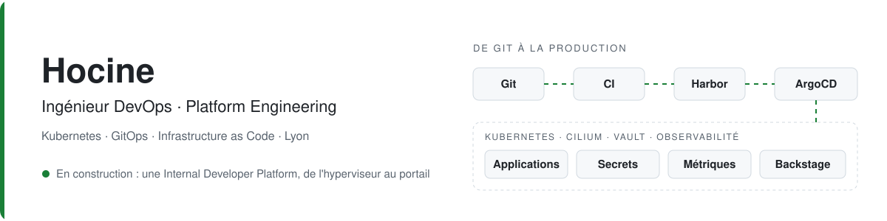

<picture>
  <source media="(prefers-color-scheme: dark)" srcset="assets/banner-dark.svg">
  
</picture>

  
  
  

Je conçois et j'exploite des chaînes de livraison multi-environnements sur Kubernetes. En parallèle, je construis seul une **Internal Developer Platform** complète sur du matériel d'occasion, pour comprendre chaque couche que les services managés cachent.

Ce qui m'intéresse : des plateformes **simples à utiliser pour les développeurs** et **solides à exploiter**, et les agents IA appliqués au DevOps et au SRE.

## En ce moment

- 🔨 **CI auto-hébergée** : runners GitHub Actions éphémères dans Kubernetes (ARC) et service de build partagé (BuildKit rootless), sans aucun pod privilégié
- 🔁 **Tout sous GitOps** : passer Harbor, Kargo et Vault sous ArgoCD, puis ajouter des garde-fous avec Kyverno
- 🧭 **Self-service** : des golden paths Backstage pour créer une application, de son dépôt à son déploiement, en un formulaire
- 📚 **Préparation de la CKA**

## Projets

<table>
  <tr>
    <td width="50%" valign="top">
      <h3><a href="https://github.com/hocine699/idp-platform-lab">idp-platform-lab</a></h3>
      
Une IDP complète sur bare-metal, de l'hyperviseur au portail développeur.

      
Proxmox · Terraform · Kubernetes 1.35 · Cilium · ArgoCD · Vault · Harbor · GitHub Actions auto-hébergé (ARC + BuildKit) · Prometheus, Loki, Tempo · Backstage

      
<b>À lire :</b> les décisions d'architecture, et les pannes réellement rencontrées.

    </td>
    <td width="50%" valign="top">
      <h3><a href="https://github.com/hocine699/deploiement-cluster-k8s-ubuntu24">deploiement-cluster-k8s-ubuntu24</a></h3>
      
Déploiement idempotent d'un cluster Kubernetes avec Ansible et kubeadm.

      
Un rôle par responsabilité · versions centralisées · ajout de nœuds et montée de version sans toucher au control plane · DNS interne forcé

      
<b>À lire :</b> les choix de conception, et la panne DNS IPv6 qui les a motivés.

    </td>
  </tr>
</table>

## Stack

  
  
  
  
  
  
  
  
  
  
  
  
  
  
  
  
  

## Ma façon de travailler

| | |
|---|---|
| **Comprendre, puis automatiser** | je construis à la main, j'automatise ensuite, et j'offre enfin en self-service |
| **Git comme seule vérité** | ce qui n'est pas dans Git n'existe pas ; ArgoCD corrige tout écart |
| **Moindre privilège** | une identité par usage, des secrets dans Vault, jamais dans un dépôt |
| **Documenter pour transmettre** | chaque choix est expliqué, chaque panne est consignée avec son diagnostic |
